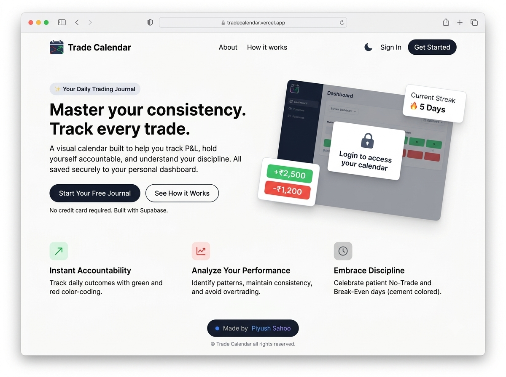
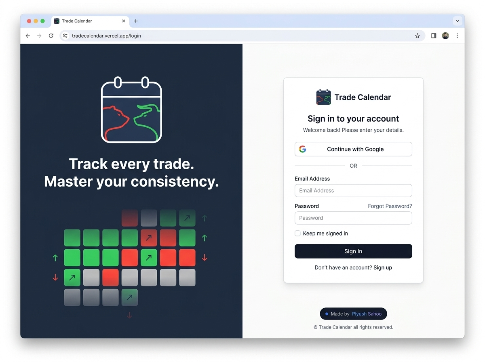

# Trade-Calendar
A full-stack daily trading P&amp;L calendar web app with color-coded profit/loss heatmaps, multi-account per-tab authentication, Day/Night mode, and row-level isolated Supabase PostgreSQL storage.
# Trade Calendar

A clean, distraction-free daily trading journal web application built to track net profit and loss (P&L) with instant visual clarity, user authentication, and row-level isolated cloud storage.

## Features

- **3-View Architecture:** Dedicated Landing Page, Split-Screen Authentication Page (Email/Password & Google Sign-In), and Personal Calendar Dashboard.
- **Color-Coded P&L Heatmap:**
  - **Green:** Profitable trading days (`Net P&L > ₹0`)
  - **Red:** Loss-making trading days (`Net P&L < ₹0`)
  - **Cement Gray:** Break-even (`₹0`) or disciplined No-Trade days
- **Interactive Trade Logging Modal:** Click any date box to log, edit, or delete daily net P&L with automatic monthly net P&L totals.
- **Per-Tab Multi-Account Isolation:** Uses `window.sessionStorage` so separate browser tabs can stay signed into different accounts simultaneously.
- **Day / Night Mode:** Persistent light and dark theme toggle across all screens.
- **Standalone Info Tabs:** Dedicated **About** and **How it works** guides opening in clean standalone browser tabs.

## Screenshots

### Landing Page

### Authentication Page

## Tech Stack

- **Frontend:** HTML5, Tailwind CSS (CDN), Custom CSS3, Vanilla JavaScript (ES6+), Inline SVG
- **Backend & Auth:** Supabase Auth (`@supabase/supabase-js@2`)
- **Database:** PostgreSQL with Row Level Security (RLS)
- **Hosting:** Vercel

